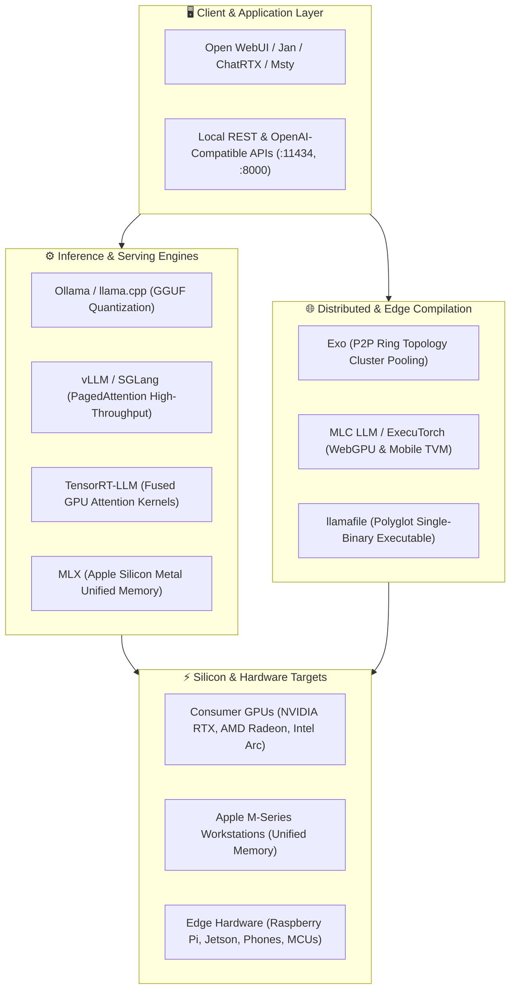

  

<h1 align="center">⚡ Awesome Local &amp; Edge Model Deployment Systems ⚡</h1>

  <strong>Curated ecosystem of SaaS platforms, open-source inference engines, quantized serving runtimes, and distributed cluster frameworks for On-Device AI &amp; Edge Computing.</strong>

  
  
  
  
  
  

---

## 📌 Overview &amp; Key Concepts

**Local &amp; Edge Model Deployment** encompasses compiling, quantizing, serving, and orchestrating machine learning models—specifically Large Language Models (LLMs), Vision-Language Models (VLMs), and audio transformers—directly on consumer hardware, workstations, single-board computers (SBCs), and distributed fleets of edge devices.

Running AI models locally delivers **complete data sovereignty**, **zero cloud egress costs**, **deterministic low latency**, and **100% offline operational resilience**. This repository indexes the leading commercial SaaS products and battle-tested open-source GitHub repositories powering modern on-device AI.

---

## 📑 Table of Contents

- [🌐 Sector Overview &amp; Market Dynamics](#-sector-overview--market-dynamics)
- [🏢 SaaS &amp; Commercial Hosted Platforms](#-saas--commercial-hosted-platforms)
- [💻 Open-Source GitHub Projects](#-open-source-github-projects)
  - [⭐ Top-Ranked Open-Source Runtimes (Sorted by Stars)](#-top-ranked-open-source-runtimes-sorted-by-stars)
  - [🧩 Architectural Categories](#-architectural-categories)
- [🏗️ Architecture Blueprint for Local Inference](#️-architecture-blueprint-for-local-inference)
- [📊 Quantization &amp; Hardware VRAM Sizing Guide](#-quantization--hardware-vram-sizing-guide)
- [🤝 How to Contribute](#-how-to-contribute)
- [💖 Support &amp; Sponsorship](#-support--sponsorship)
- [##  Star History](#--star-history)
- [⚖️ Disclaimer](#️-disclaimer)

---

## 🌐 Sector Overview &amp; Market Dynamics

The global **Edge AI and Local Model Deployment** market is estimated at **$20.4B–$28.5B in 2024–2025** and is projected to expand to **$65B–$105B+ by 2030–2032** (compounding at a robust **~26.8% CAGR**), driven by strict enterprise privacy mandates, real-time zero-latency edge inference, and soaring per-token cloud egress bills.

The market structure is **moderately fragmented and highly modular** rather than a single winner-take-all monopoly: while specialized silicon and GPU acceleration remain concentrated among giants like NVIDIA (with Apple Silicon unified memory, AMD ROCm, and Qualcomm Snapdragon NPU gaining strong ground at consumer edge), the inference runtime and compilation software layer is heavily open-source dominated (`llama.cpp`, `vLLM`, `Ollama`, `MLC LLM`), preventing vendor lock-in and allowing decentralized P2P cluster pooling, local desktop wrappers, and bespoke enterprise edge orchestrators to thrive together.

---

## 🏢 SaaS &amp; Commercial Hosted Platforms

The following commercial platforms and developer-focused SaaS suites provide turnkey desktop GUIs, managed edge fleets, and production enterprise inference microservices.

> *Sorted descending by company size (Valuation / Market Cap / Revenue).*

| 🏢 Product | 💰 Company Size &amp; Valuation | 🎯 Focus &amp; Core Capabilities | 🏷️ Starting Pricing | 🎁 Free Tier / Free Trial Limits |
| :--- | :--- | :--- | :--- | :--- |
| **[NVIDIA (ChatRTX &amp; NIM)](https://www.nvidia.com/en-us/ai-on-rtx/chatrtx/)** | **~$3.0T+** Market Cap • **~$120B+** Annual Revenue | Optimized RTX desktop RAG playground and enterprise containerized microservices for high-throughput edge inference using TensorRT-LLM. | ChatRTX is **$0 (Free)**; NVIDIA AI Enterprise / NIM microservices start at **$4,500/GPU/year** (~$375/GPU/mo) or **$1.00/GPU-hour** | **100% Free Forever** for ChatRTX on Windows desktop (requires RTX 30/40 GPU with ≥8GB VRAM); **90-day free trial** for NVIDIA NIM with 1,000 API inference credits. |
| **[Modular (MAX Engine)](https://www.modular.com/)** | **$600M** Valuation *(Series A, $130M Raised)* | High-performance unified AI engine and Mojo compiler delivering sub-millisecond CPU and GPU inference across heterogeneous edge hardware. | MAX Community Edition is **$0 (Free)**; MAX Enterprise commercial deployments start at **$500/month** (plus compute unit fees starting at $0.08/unit) | **Free Forever** for MAX Community Edition for local compilation, single-node serving, and developer prototyping on local workstations. |
| **[Edge Impulse](https://www.edgeimpulse.com/)** | **~$220M** Valuation *(Series B, $54M Raised)* | End-to-end edge ML platform for training, compiling, and deploying sensor, vision, and quantized LLM models to MCUs, SBCs, and IoT gateways. | Developer Plan is **$0 (Free)**; Enterprise production fleet deployment licenses start at **~$4,000/year** (~$333/month) | Developer Plan is **Free Forever** with up to 3 private projects, unlimited public projects, 3 collaborators, 60 min compute time per training job, and up to 1,000 on-device deployments. |
| **[BentoML (BentoCloud)](https://www.bentoml.com/)** | **~$100M** Valuation *($9M+ Raised)* | Unified model packaging and serving framework with BentoCloud managing hybrid edge/cloud model endpoints, autoscaling, and container distribution. | BentoCloud Starter tier starts at **$50/month** (with Pay-as-you-go serverless GPU compute starting at $0.05/hour) | Developer Tier is **Free Forever** with **$10/month recurring free compute credits**, up to 3 active deployments, and unlimited local/edge BentoML exports. |
| **[LM Studio](https://lmstudio.ai/)** | **~$35M–$50M** Valuation *(Estimated)* • >3.5M+ Downloads | Polished desktop application and local OpenAI-compatible API server for discovering, quantizing, and running GGUF &amp; MLX models with zero configuration. | Core Desktop app is **$0 (Free)**; LM Studio Bionic+ cloud agent tier starts at **$20/month** (Pro plan at **$100/month**; custom enterprise fleet licensing) | Desktop application is **100% Free Forever** for personal, educational, and commercial work use with unlimited local inference, zero message throttling, and offline operation. |
| **[AnythingLLM (Mintplex Labs)](https://anythingllm.com/)** | **~$15M–$25M** Valuation *(Seed Backed)* • >1M+ Installs | All-in-one local RAG application and multi-user workspace compatible with Ollama, LocalAI, LM Studio, and embedded vector engines. | Desktop &amp; Docker are **$0 (Free)**; AnythingLLM Cloud Basic starts at **$50/month** (Pro tier at **$99/month**; optional Desktop Pro upgrade at **$15/month**) | Desktop and self-hosted Docker builds are **100% Free Forever** (MIT licensed) with unlimited local document RAG, local chat threads, and unlimited vector storage. |
| **[Msty (Msty Studio)](https://msty.app/)** | **~$5M–$10M** Scale *(Bootstrapped)* • >250k+ Users | Desktop AI workspace with split-screen multi-model comparison, local RAG knowledge stacks, offline persona builders, and multi-engine routing. | Free Plan is **$0 (Free)**; Aurum Pro starts at **$149/year** (~$12.42/month) or **$349 one-time** lifetime license; Teams tier starts at **$300/user/year** (5-seat min) | Free Plan is **Free Forever** with local Ollama/llama.cpp/MLX integration, unlimited chats, offline RAG knowledge stacks, and multi-model split view. |
| **[Jan (Homebrew / JanHQ)](https://jan.ai/)** | **~$3M–$5M** Scale *(Open Source Incubated)* • >1.5M+ Downloads | Privacy-first open-source ChatGPT alternative running 100% offline via llama.cpp and TensorRT-LLM with integrated local REST server. | Core software is **$0 (100% Free Open Source)**; Commercial SLA and custom enterprise integration support packages start at **~$15/user/month** (~$1,200/mo min retainer) | Jan Desktop is **100% Free Forever** (AGPL-3.0) with zero feature paywalls, zero telemetry, unlimited offline inference sessions, and full local GGUF/TensorRT-LLM support. |

---

## 💻 Open-Source GitHub Projects

### ⭐ Top-Ranked Open-Source Runtimes (Sorted by Stars)

Every open-source project below provides community-driven code for compiling, quantizing, serving, and orchestrating models locally.

> *Sorted descending by GitHub stargazer count.*

1. **[Ollama](https://github.com/ollama/ollama)**   
   **The premier tool for local model management and serving.** Pull models via simple CLI commands (`ollama run llama3.3`), expose an OpenAI-compatible REST API at `localhost:11434`, and customize models with standard Modelfiles. Cross-platform acceleration across macOS (Metal), Windows/Linux (CUDA, ROCm). MIT licensed.

2. **[Open WebUI](https://github.com/open-webui/open-webui)**   
   **Feature-rich, self-hosted web UI for local and edge LLMs.** Acts as a responsive frontend for Ollama and OpenAI-compatible inference servers, featuring integrated document RAG, voice interaction, granular role-based access control, and pipeline extensions. MIT licensed.

3. **[llama.cpp](https://github.com/ggerganov/llama.cpp)**   
   **The foundational C/C++ inference engine for quantized LLMs.** Created by Georgi Gerganov, it pioneered the GGUF model format with minimal third-party dependencies. Features SIMD CPU acceleration (AVX2, AVX-512, ARM NEON) and GPU offloading (CUDA, Metal, Vulkan, ROCm, SYCL). MIT licensed.

4. **[vLLM](https://github.com/vllm-project/vllm)**   
   **High-throughput serving engine for production inference.** Features PagedAttention to eliminate memory fragmentation in KV caches, continuous batching, chunked prefill, and speculative decoding. Scales from single consumer GPUs to multi-node clusters. Apache 2.0 licensed.

5. **[GPT4All](https://github.com/nomic-ai/gpt4all)**   
   **Local AI ecosystem for consumer hardware.** Maintained by Nomic AI, providing a cross-platform desktop GUI alongside Python and TypeScript bindings. Includes a curated library of pre-quantized models runnable entirely offline on consumer CPUs and GPUs. MIT licensed.

6. **[PrivateGPT](https://github.com/zylon-ai/private-gpt)**   
   **Production-ready offline RAG pipeline.** Built to query documents using 100% local LLMs and embeddings with zero data leakage. Compatible with llama.cpp, Ollama, and LocalAI backends. Apache 2.0 licensed.

7. **[Whisper.cpp](https://github.com/ggerganov/whisper.cpp)**   
   **High-performance C/C++ port of OpenAI's Whisper speech recognition model.** Delivers real-time on-device audio transcription on Raspberry Pi, iOS, Android, and consumer laptops with zero external dependencies. MIT licensed.

8. **[LocalAI](https://github.com/mudler/LocalAI)**   
   **Free, open-source drop-in OpenAI REST API replacement.** Runs LLMs, image generation (Stable Diffusion), audio transcription (Whisper), and embeddings locally without requiring GPUs. Supports multiple backends (llama.cpp, vLLM, Diffusers). MIT licensed.

9. **[Exo](https://github.com/exo-explore/exo)**   
   **Distributed cluster orchestrator for everyday hardware.** Pools phones, laptops, and mini-PCs into a unified computing cluster using peer-to-peer ring topology and dynamic tensor/pipeline model partitioning. GPL-3.0 licensed.

10. **[text-generation-webui](https://github.com/oobabooga/text-generation-webui)**   
    **The classic Gradio-based powerhouse web UI for LLMs.** Supports multiple inference backends simultaneously, including Transformers, llama.cpp, ExLlamaV2, and AutoAWQ, with extensive parameter tuning and LoRA extension support. AGPL-3.0 licensed.

11. **[Jan](https://github.com/janhq/jan)**   
    **Open-source ChatGPT alternative that runs offline on your machine.** Clean desktop interface with local model downloads, hardware usage monitoring, customizable system prompts, and an integrated local HTTP server powered by `nitro`. AGPL-3.0 licensed.

12. **[Langchain-Chatchat](https://github.com/chatchat-space/Langchain-Chatchat)**   
    **Complete local knowledge base Q&amp;A framework.** Combines LangChain with local LLMs and embedding models to deliver secure, enterprise-grade on-premise document search and agent workflows. Apache 2.0 licensed.

13. **[SGLang](https://github.com/sgl-project/sglang)**   
    **High-performance structured generation framework.** Accelerates complex LLM workflows via RadixAttention (automatic KV cache reuse across multiple calls), speculative decoding, and native JSON schema output enforcement. Apache 2.0 licensed.

14. **[tinygrad](https://github.com/tinygrad/tinygrad)**   
    **Extremely minimal deep learning framework by George Hotz.** Compiles tensor operations into raw C/OpenCL/Metal/CUDA kernels in under 10,000 lines of code, offering a lightweight alternative for edge training and inference. MIT licensed.

15. **[MLX](https://github.com/ml-explore/mlx)**   
    **Apple's native machine learning framework for Apple Silicon.** Delivers zero-overhead unified memory access across M-series CPU and GPU cores, providing record inference speeds for Llama, Mistral, and Qwen on Mac hardware. MIT licensed.

16. **[llamafile](https://github.com/mozilla-ai/llamafile)**   
    **Run LLMs from a single self-contained executable.** Combines llama.cpp with Cosmopolitan Libc to package weights and inference code into a cross-platform polyglot binary runnable across Windows, macOS, Linux, and BSD. Apache 2.0 licensed.

17. **[MLC LLM](https://github.com/mlc-ai/mlc-llm)**   
    **Universal machine learning compiler for edge devices.** Uses Apache TVM to compile and optimize models across WebGPU (in-browser), iOS, Android, Linux, and Windows with native hardware shader compilation. Apache 2.0 licensed.

18. **[candle](https://github.com/huggingface/candle)**   
    **Minimalist ML framework written in pure Rust by Hugging Face.** Designed for serverless and resource-constrained edge deployments with zero Python runtime overhead and native WASM support. Apache 2.0 / MIT licensed.

19. **[TensorRT-LLM](https://github.com/NVIDIA/TensorRT-LLM)**   
    **NVIDIA's premier GPU inference optimization library.** Provides state-of-the-art fused multi-head attention kernels, FP8/INT4 quantization, in-flight batching, and multi-GPU tensor parallelism. Apache 2.0 licensed.

20. **[LLM CLI](https://github.com/simonw/llm)**   
    **Modular CLI tool and Python library for running prompts and embeddings.** Created by Simon Willison, featuring an extensive plugin ecosystem supporting local llama.cpp, Ollama, and remote providers. Apache 2.0 licensed.

21. **[OpenLLM](https://github.com/bentoml/OpenLLM)**   
    **Operating system for open-source LLMs in production.** Maintained by BentoML to serve open-weight models with a single CLI command (`openllm start llama3`), built-in OpenAPI spec, and Docker compilation. Apache 2.0 licensed.

22. **[KoboldCpp](https://github.com/LostRuins/koboldcpp)**   
    **Easy single-file executable for GGUF model inference.** Bundles llama.cpp with a built-in browser UI, text adventure engine, and OpenAI-compatible API without needing Python or complex build toolchains. AGPL-3.0 licensed.

23. **[Text Generation Inference (TGI)](https://github.com/huggingface/text-generation-inference)**   
    **Hugging Face's production serving engine.** Engineered for high-load model serving with continuous batching, token streaming, FlashAttention, and tensor parallelism across multiple GPUs. Apache 2.0 licensed.

24. **[PowerInfer](https://github.com/Tiiny-AI/PowerInfer)**   
    **High-speed hybrid CPU/GPU inference engine.** Exploits neuron activation sparsity in LLMs, loading only "hot" neurons into GPU VRAM while streaming "cold" neurons through the CPU, enabling larger models on consumer graphics cards. MIT licensed.

25. **[ExecuTorch](https://github.com/pytorch/executorch)**   
    **PyTorch's official on-device edge runtime.** Provides a compact, portable execution engine for deploying PyTorch models to mobile phones (iOS, Android), microcontrollers, and edge NPUs with hardware delegate acceleration. BSD-3-Clause licensed.

26. **[ExLlamaV2](https://github.com/turboderp-org/exllamav2)**   
    **Ultra-fast inference library optimized for consumer GPUs.** Features custom CUDA kernels and the proprietary EXL2 format (sub-4-bit quantization with variable bits per weight) for maximizing generation speed. MIT licensed.

27. **[ONNX Runtime GenAI](https://github.com/microsoft/onnxruntime-genai)**   
    **Microsoft's generative AI execution engine.** Simplifies running local quantized models on Windows, Linux, and mobile hardware through DirectML, CUDA, and CPU execution providers. MIT licensed.

---

### 🧩 Architectural Categories

| Category | Primary Open-Source Tools | Target Use Case |
| :--- | :--- | :--- |
| **Desktop &amp; Turnkey Serving** | `Ollama`, `KoboldCpp`, `llamafile`, `GPT4All` | Developers &amp; local users wanting one-command model downloads and instant API access. |
| **High-Throughput Serving** | `vLLM`, `SGLang`, `TGI`, `OpenLLM` | Production clusters, multi-tenant APIs, continuous batching, and KV cache reuse. |
| **Low-Level C++ / Rust Kernels** | `llama.cpp`, `candle`, `tinygrad`, `PowerInfer` | Embedded platforms, SBCs, serverless functions, and minimal dependency deployments. |
| **Edge, Mobile &amp; WebGPU** | `MLC LLM`, `ExecuTorch`, `ONNX Runtime GenAI` | Android, iOS, in-browser WebGPU, edge NPUs, and battery-constrained IoT devices. |
| **Apple Silicon Acceleration** | `MLX`, `llama.cpp (Metal)` | M1/M2/M3/M4 Macs leveraging up to 128GB+ unified memory for large model inference. |
| **Consumer GPU Quantization** | `ExLlamaV2`, `TensorRT-LLM` | Maximum tokens/sec on NVIDIA RTX 30/40 series cards using EXL2, AWQ, and INT4. |
| **Distributed Device Pooling** | `Exo` | Linking heterogeneous household hardware into a single virtual cluster. |

---

## 🏗️ Architecture Blueprint for Local Inference

---

## 📊 Quantization &amp; Hardware VRAM Sizing Guide

Model size on consumer hardware is constrained primarily by **available VRAM and unified memory bandwidth**.

$$\text{Estimated VRAM Required (GB)} \approx \left(\text{Parameter Count in Billions} \times \frac{\text{Bits Per Weight}}{8}\right) \times 1.25 + 1.5\text{ GB (KV Cache \& Overhead)}$$

| Model Parameter Size | Quantization Format | Typical File Size | Minimum Required VRAM | Target Hardware Recommendation |
| :--- | :--- | :--- | :--- | :--- |
| **3B–4B** (e.g. Llama 3.2 3B, Phi-3.5) | Q4_K_M (4-bit GGUF) | ~2.2 GB | **4 GB** | Mid-range laptops, Raspberry Pi 5 (8GB), iPhone 15/16 Pro |
| **7B–8B** (e.g. Llama 3.1 8B, Qwen 2.5 7B) | Q4_K_M (4-bit GGUF) | ~4.9 GB | **6 GB – 8 GB** | NVIDIA RTX 3060/4060 (8GB/12GB), Apple M1/M2 Mac (16GB) |
| **8B** (High Quality) | Q8_0 (8-bit GGUF) | ~8.5 GB | **10 GB – 12 GB** | NVIDIA RTX 3060 12GB / RTX 4070 (12GB) |
| **14B** (e.g. Qwen 2.5 14B) | Q4_K_M (4-bit GGUF) | ~8.9 GB | **12 GB** | NVIDIA RTX 3060 12GB / RTX 4070 Ti (12GB/16GB) |
| **32B** (e.g. Qwen 2.5 32B) | Q4_K_M (4-bit GGUF) | ~19.8 GB | **24 GB** | Single NVIDIA RTX 3090 / 4090 (24GB) or Mac (32GB+) |
| **70B** (e.g. Llama 3.3 70B) | Q4_K_M (4-bit GGUF) | ~42.5 GB | **48 GB** | 2× RTX 3090/4090 (48GB) or Apple M-Series Mac (64GB–128GB) |
| **70B** (Exo Distributed) | Q4_K_M Distributed | ~42.5 GB | **Cluster Pool** | 3–4 standard laptops pooled via `exo` P2P cluster |

---

## 🤝 How to Contribute

Contributions from the local AI and edge computing community are warmly encouraged!

1. 🍴 **Fork the repository** on GitHub.
2. 📝 **Add or update entries** in `README.md` (maintain tabular structure for SaaS and star-sorted order for open-source projects).
3. 📌 **Include essential details**: Name, homepage/repo link, star badge, pricing/free tier limitations, and primary platform support.
4. 📬 **Submit a Pull Request** with a clear explanation of your additions.
5. 🔗 For related curated awesome lists, check out [Awesome Awesome Awesome](https://github.com/ishandutta2007/Awesome-Awesome-Awesome).

---

## 💖 Support &amp; Sponsorship

Thank you for exploring and utilizing the **Awesome Local &amp; Edge Model Deployment Systems** list! If this repository has helped you design offline AI workflows, cut cloud inference costs, or discover local tools, please consider supporting the project:

- ⭐ **Star this repository** on GitHub to amplify its reach across the open-source community.
- 🔀 **Fork &amp; Share** it with your developer peers, edge AI teams, and privacy enthusiasts.
- ☕ **Buy Me a Coffee / Sponsor**: Support ongoing maintenance and continuous ecosystem updates via the [GitHub Sponsor Dashboard](https://github.com/sponsors/ishandutta2007).

  

---

##  Star History

---

## ⚖️ Disclaimer

- This list is **community-curated** for informational and educational purposes only.
- Model quality is heavily dependent on quantization schemes—aggressive sub-4-bit quantization reduces memory footprint but may induce degradation on complex reasoning benchmarks.
- On-device edge deployment requires careful consideration of device thermal limits, battery dissipation, and compatible driver architectures (CUDA, ROCm, Metal, Vulkan, DirectML). Always benchmark on your target edge hardware.

---

  <strong>Built with ⚡ for privacy-first developers, edge engineers, and the open-weight AI community.</strong>

